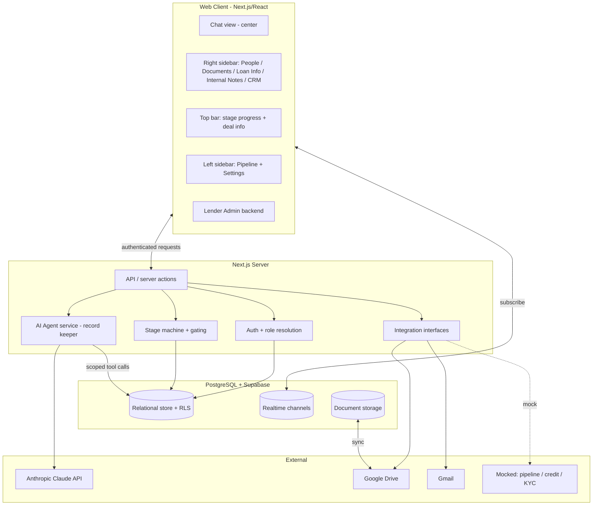
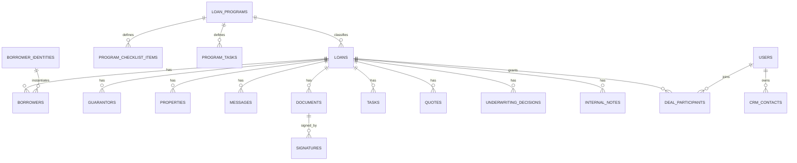
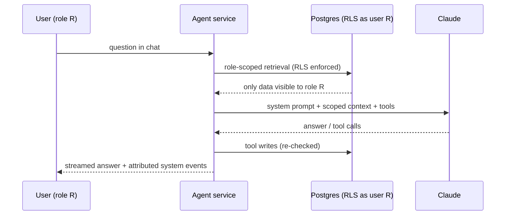

# Design — Chat-Driven Private Loan Origination System (Prototype)

**Status:** Draft for review (rev 4) · **Date:** 2026-10-25 · **Method:** Spec-Driven Development (Phase 2 of 3)
**Traces:** [requirements.md](requirements.md) rev 5. Requirement IDs (e.g., `R-PROC-8`) are referenced inline.

---

## 1. Overview and design goals

The system is a **chat-centered web application** for private loan origination. Every deal is one shared conversation (borrower, originator, lending team) plus an **AI "record keeper & originator"** that answers questions, maintains the structured record, and drives each stage. Structured loan data lives in a relational datastore (system of record); Google Drive is a synchronized document backup; Gmail carries correspondence.

**Design goals**

1. **Chat is the application**, not a feature bolted onto a form. Structured data and documents are surfaced in sidebars/pop-outs, but the primary interaction is conversational (R-UI-1).
2. **Role-scoped everything.** Access control (borrower / originator / lending-team types) is enforced at the data layer, not just the UI, including the AI's context window (R-NOTES-3, R-NFR-5).
3. **Deterministic flow, assisted by AI.** Stage gates, checklists, and approvals are deterministic state machines; the AI assists (extraction, review, drafting, answering) but never silently advances stages (R-STAGE-3) or sends email (R-MAIL-4).
4. **Swappable integrations.** Pricing, e-signature, pipeline, and credit/KYC sit behind interfaces so the mocked prototype parts can be replaced (R-NFR-6).
5. **Auditable.** Every state change is an attributed, timestamped event (R-AUDIT-1).

---

## 2. Technology stack (recommended)

| Concern | Choice | Why |
|---|---|---|
| **Frontend** | **Next.js (React, TypeScript)** + Tailwind CSS | One framework for the chat UI, sidebars, admin backend, and server APIs; strong streaming support for AI responses. |
| **Backend/API** | **Next.js server actions + route handlers** (Node) | Keeps the prototype to one deployable; clean server boundary for secrets (Google, Anthropic). |
| **Datastore (system of record)** | **PostgreSQL via Supabase** | Relational model fits loan/property/borrower/guarantor/trade; **Row-Level Security (RLS)** maps directly onto the access rules; gives us Auth + Realtime + Storage in one. |
| **Auth** | **Supabase Auth** | Native **magic-link**, **email/password**, and **Google OAuth** (R-AUTH-2/3/4); issues JWTs that carry role claims used by RLS. |
| **Real-time chat** | **Supabase Realtime** (Postgres logical replication → websockets) | Near-real-time multi-participant chat and record updates (R-NFR-9). |
| **Document bytes** | **Supabase Storage** (primary) mirrored to **Google Drive** | Platform is source of truth; Drive is the synchronized backup (R-DRIVE-3, decision #20). |
| **AI** | **Anthropic Claude** (`claude-opus-4-8` for review/underwriting assist; a faster model such as `claude-haiku-5-5` for routine chat) via the Messages API with tool use | The record-keeper agent; tool-calling drives structured reads/writes. |
| **Google integration** | **Google Drive API** + **Gmail API** (OAuth, lending-team Google account) | Folder/file sync and correspondence (§8, §9). |
| **PDF / templates** | `pdf-lib` (fillable PDFs), `docxtemplater` or equivalent (docx), for hashtag substitution and inline fill/sign | Term sheet, full application, closing docs (§7, R-TAG). |
| **Background jobs** | Lightweight queue (Supabase scheduled functions / a small worker) | Drive sync reconciliation, reminder cadences, inbound-email matching. |

> **Fully-local alternative (if you prefer no third-party accounts for the prototype):** Postgres in Docker + a Node/Express server + a self-hosted auth library (Lucia) + websockets (Socket.IO). Same data model and interfaces; swap Supabase-specific pieces. Supabase is recommended because Auth + RLS + Realtime + Storage remove ~40% of the prototype's plumbing.

---

## 3. High-level architecture



**Key idea:** the **Integration Layer** exposes stable interfaces — `DocumentStore`, `MailService`, `PricingProvider`, `ESignProvider`, `PipelineProvider`, `CreditProvider` — with real implementations for Drive/Gmail and mocks for the rest (R-NFR-6).

---

## 4. Data model

Entities and the most important fields (Postgres tables). Access columns noted where relevant.

### 4.1 Identity & access
- **`users`** — `id`, `email`, `full_name`, `phone`, `auth_provider`, `is_lending_team` (bool), `lender_user_type` (`admin|operations|account_manager`, null for external), `created_at`.
- **`deal_participants`** — join of `users` ↔ `loans`: `loan_id`, `user_id`, `participant_role` (`borrower|originator|lending_team`), `added_by`, `added_at`. Drives per-deal access (R-AUTH-1).
- **`crm_contacts`** — `id`, `owner_user_id` (Account Manager or Admin), `name`, `email`, `phone`, `notes`. Visible to owner; all visible to Admin with owner label (R-ADMIN-3/4/5).

### 4.2 Loan core
- **`loans`** — `id`, `loan_number` (e.g., `SPHX500`), `program_id`, `account_manager_id`, `stage`, `status` (`active|on_hold|withdrawn|declined`), `loan_type`, `loan_amount`, `expected_close_date`, `drive_folder_id`, `created_at`. (R-UI-7, R-DRIVE-2.)
- **`loan_number_seq`** — single-row/sequence guaranteeing monotonic, non-reused numbers from 500 (R-DRIVE-1).
- **`borrowers`** — `id`, `loan_id`, `borrower_kind` (`individual|entity`), `entity_type` (`corporation|llc|trust|null`), name fields, `contact_info`, `mailing_address`, `locked` (bool). A borrower identity may be linked across loans (see §4.7). (R-DATA-6, R-INTAKE-12.)
- **`guarantors`** — `id`, `loan_id`, individual fields (R-DATA-5).
- **`properties`** — `id`, `loan_id`, `address`, `property_type`, details JSON. Multiple per loan (R-DATA-7).
- **Custom fields & tags (simplified):** core fields live in the **typed columns** above; admin-added custom fields live in a per-section **`custom_fields` JSONB** column on the relevant table, plus a **`trade_data`** table (lending-team-only, R-UI-6 / R-TRADE-1). A small **`field_tags`** table maps each field (typed or custom) to its unique `#hashtag` (R-TAG-1) and holds its `editable_by` role mask (R-ADMIN-15). _(This replaces an earlier full key/value/EAV table — see §17.)_

### 4.3 Programs & configuration
- **`loan_programs`** — `id`, `name` (Bridge, Fix&Flip, New Construction, DSCR, Commercial Bridge, Commercial Permanent, …), `loan_type_key` (maps intake loan type → program, R-INTAKE-11), `pricing_mode` (`model|guidelines`), `pricing_model` JSON, `guidelines_text`, `intake_flow` JSON (conditional, R-ADMIN-12), `prequal_rules` JSON (R-ADMIN-13), `termsheet_template_id`, `application_template_id`.
- **`document_types`** (Library) — shared catalog: `id`, `key`, `label`, `default_naming_convention`, `default_ai_review_rules` (nullable). Defined once, referenced by programs (R-ADMIN-8/9).
- **`program_checklist_items`** — a program's **reference + overrides** to a document type: `program_id`, `document_type_id`, `required` (bool), `naming_override`, `ai_review_rules_override` (nullable), `default_assignee_role`. Effective value = override ?? library default (§13).
- **`program_tasks`** — `program_id`, `label`, `default_assignee` (borrower | specific lending role), `visible_to_borrower` (bool; lender tasks false, R-TASK-2), `order`.
- **`email_templates`** / **`automated_email_config`** — which events auto-draft which templates (R-ADMIN-14).

### 4.4 Conversation & history
- **`messages`** — `id`, `loan_id`, `sender_user_id` (null for AI/system), `sender_kind` (`human|ai|system`), `sender_role`, `is_internal` (bool, lender-only), `body`, `attachments`, `created_at` (R-CHAT-3/4/7, R-NOTES-1).
- **`audit_events`** — append-only: `loan_id`, `actor`, `actor_kind`, `event_type`, `payload`, `created_at` (R-AUDIT-1/2).

### 4.5 Documents & tasks
- **`documents`** — one table for both **uploaded and generated** documents: `id`, `loan_id`, `source` (`uploaded|generated`), `doc_type`, `display_name` (after re-label, R-PROC-5), `storage_path`, `drive_file_id`, `status` (`outstanding|update_needed|approved`), `template_id` (generated only), `version`, `supersedes` (R-QTS-7), `reviewed_by`, `review_reason`, `uploaded_by`, `created_at`, `deleted_at` (soft-delete for the confirm/sync guardrail, R-DRIVE-4/5).
- **`checklist_items`** — per-loan instances of program checklist items with current `status`.
- **`tasks`** — per-loan instances of program tasks: `assignee_user_id`, `status`, `completed_at`, `visible_to_borrower` (R-TASK-*).

### 4.6 Quote, term sheet, decisions, signatures
- **`quotes`** — `loan_id`, `version`, pricing fields (rate, term, points/fees, est. payment, LTV), `source` (`model|manual`), `created_by`, `accepted_at`, `accepted_by` (R-QTS-2/3/7).
- _(Generated docs — term sheets, applications, closing docs — are rows in **`documents`** with `source='generated'`; see §4.5. No separate table.)_
- **`signatures`** — `document_id`, `signer_user_id`, `signed_at`, `ip_address`, `geo_location`, `auth_page_ref` (R-QTS-5).
- **`underwriting_decisions`** — `loan_id`, `decision` (`approve|approve_with_conditions|decline|counter`), `rationale`, `decided_by`, `created_at` (R-UW-2).
- **`conditions`** — `loan_id`, `text`, `satisfied` (bool), `satisfied_at` (R-UW-3, R-APPR-2).
- **`approvals`** — `loan_id`, `approver_id` (Admin), `approved_at`, `locked_terms` JSON (R-APPR-3).
- **`internal_notes`** — `loan_id`, `author_id`, `body`, `created_at`. Lender-only (R-NOTES-1).

### 4.7 Cross-loan borrower identity
- **`borrower_identities`** — canonical person/entity record; `borrowers` rows reference a `borrower_identity_id`. A change to shared borrower-identity info propagates to that identity's **non-closed** loans (R-DATA-2) and is blocked for closed ones (R-DATA-3). Closed = Post-Close (decision #12).

### 4.8 Entity-relationship sketch



---

## 5. Access control and the AI boundary

Access is enforced in **three layers**, so a UI bug can't leak lender-only data:

1. **Postgres RLS** — every table carries policies keyed on the caller's JWT (`is_lending_team`, `lender_user_type`, and membership in `deal_participants`). Borrowers/originators can only `SELECT` rows for loans they're participants on, and **never** `internal_notes`, `trade` loan_fields, or lender-only tasks (R-AUTH-1, R-NOTES-2, R-TASK-2).
2. **API/service layer** — server actions re-check role before mutations and stage transitions.
3. **AI context assembly** — the agent service builds the model's context **from role-scoped queries run as the asking user**. When a borrower/originator asks a question, the retrieval step cannot even read internal notes or trade data, so the model cannot repeat them (R-NOTES-3). When the lending team asks, those sources are included (R-NOTES-4).



**Why this matters:** the confidentiality guarantee (R-NFR-5) does not depend on prompt wording. Even a jailbreak can't surface internal notes to a borrower because the data never entered the model's context.

### 5.1 Hard security rules (must hold)

- **Never answer with the service-role key.** All user-facing reads (including the AI's retrieval) run through a **user-scoped Postgres connection carrying the caller's JWT**, so RLS applies. The elevated `service_role` key is used only by trusted, non-conversational background jobs (Drive reconciliation, sequence assignment) — **never** in the request/answer path. This is the single most important rule; bypassing RLS with the service key would re-open every leak path.
- **Scope = current loan ∩ the user's accessible loans.** A deal chat retrieves only the current loan's data, further intersected with the user's `deal_participants` memberships. A borrower cannot pull another borrower's loan into the conversation even if they ask by loan number — RLS returns nothing.
- **Tool writes are re-authorized server-side** against the caller's role; the model's requested write is treated as a proposal, not an authorization.
- **Uploaded content is untrusted data.** Document text and transcripts are passed to the model as data, never as instructions; tool calls triggered from document content still obey role checks and human-confirmation gates, so a malicious uploaded file cannot exfiltrate lender-only data (it was never retrieved) or silently act.

### 5.2 General program questions (borrower-safe)

Program records hold **two tiers**: **public program info** (names, general terms, eligibility highlights — borrower-safe) and **internal config** (`pricing_model`, `ai_review_rules`, internal guidelines — lender-only). RLS exposes only the public tier to borrowers/originators. The AI can answer general "what are your DSCR terms?" questions in any deal chat from the public tier (via `get_program_info`, §6), while internal pricing/review logic stays walled off.

### 5.3 Honest scope: "secure by design," not "provably secure"

The design is **defense-in-depth** (RLS + service re-checks + context scoping) so that no single bug leaks data, and the cross-borrower and internal-notes guarantees hold **provided the hard rules in §5.1 are followed**. It is not a completed security audit: for the prototype we explicitly defer penetration testing, formal threat modeling, rate-limiting/abuse controls, and e-sign legal hardening (§14). Those are the known gaps, called out rather than implied-complete.

---

## 6. AI "record keeper & originator" agent

A tool-using Claude agent, instantiated per request with the caller's role and loan context.

**Capabilities (tools):**
- `get_loan_record(section?)` — read scoped loan data.
- `get_program_info(program?)` — read **borrower-safe** program info for general questions (§5.2); internal pricing/review config is not exposed through this tool to borrowers/originators.
- `update_loan_fields(changes)` — write field updates (subject to field permissions, R-ADMIN-15; records audit event).
- `extract_intake(input)` — from text/audio-transcript/document, extract intake fields for confirmation (R-INTAKE-6).
- `get_checklist()` / `set_document_type(doc, type)` / `review_document(doc)` — processing support; `review_document` applies the program's per-doc `ai_review_rules` and proposes `approved|update_needed` with a reason (R-PROC-8).
- `fill_template(template_id)` — substitute `#hashtag` variables with current loan data (R-TAG-2).
- `draft_email(event|freeform)` — prepare a Gmail draft for **human approval** (never sends; R-MAIL-4).
- `propose_stage_advance()` — when gates are met, surface the "ready to advance" prompt to Admin (never advances itself; R-STAGE-3/4).

**Guardrails:**
- Voice/audio and documents are transcribed/parsed, then fields are **confirmed back** before being written (R-INTAKE-6).
- The agent proposes; deterministic services commit stage changes, approvals, deletes, and sends.
- **Uploaded document text and transcripts are treated as untrusted data, not instructions** (§5.1); the agent summarizes/extracts from them but does not obey directives embedded in them.
- Model selection: routine conversation on a fast model; document review and underwriting-summary assembly on `claude-opus-4-8`.

---

## 7. Stage machine and gating

A single **deterministic state machine** owns `loans.stage`. The AI and UI can request transitions; only the machine commits them, and only with Admin approval (R-STAGE-3).

| Stage | Entry gate (readiness) | Exits |
|---|---|---|
| Intake | new loan started | → Pre-Qualification when required intake fields captured |
| Pre-Qualification | intake complete | → Quote & Term Sheet on Pass/override |
| Quote & Term Sheet | prequal passed | → Processing when term sheet **Signed** |
| Processing | term sheet signed | → Underwriting when all required checklist items **Approved** |
| Underwriting | processing complete | → Final Approval (approve), → Quote&TS (counter), → Declined |
| Final Approval | all conditions satisfied | → Closing when terms locked/approved |
| Closing | final approval | → Post-Close when closing tasks complete + funding confirmed |
| Post-Close | funded | (servicing; borrower data locked) |

Branch states **On Hold / Withdrawn / Declined** reachable from any active stage (R-STAGE-6). Each transition writes an `audit_event` and posts a system message. On opening a "ready" loan, the Admin gets the advance prompt (R-STAGE-4); the current-stage banner is posted fresh unless it was the last message (R-STAGE-5).

---

## 8. Integration design

### 8.1 Google Drive (`DocumentStore`)
- **Folder creation:** on intake submit, create `Open Loan Files / {LoanNumber} {PropertyAddress} {BorrowerName}` (R-DRIVE-2) with the standard subfolder structure; store `drive_folder_id` on the loan.
- **Upload mirroring:** platform upload → write bytes to Supabase Storage (primary) → mirror to the correct Drive subfolder (R-DRIVE-3). Re-label using the program's naming convention before mirroring (R-PROC-5).
- **Two-way deletion:** platform delete requires a **confirm dialog** stating Drive removal (R-DRIVE-5); on confirm, soft-delete locally then delete the Drive file. Drive-side deletions are detected via **Drive `changes` watch (push) + periodic reconciliation**, and remove the platform record (R-DRIVE-4). A reconciliation job handles missed events.
- **Templates folder:** a configured Drive folder holds term sheet / full application / authorization / LOE / closing templates (R-DRIVE-6); Admin maps templates to programs (R-ADMIN-11).
- **Failure handling:** a failed Drive op surfaces in chat and the dependent step is **not** marked complete (R-DRIVE-7).

### 8.2 Gmail (`MailService`)
- All sends create a **Gmail draft** first; a lending-team user approves per-message before send (R-MAIL-4), including automated-event emails which are queued as drafts (R-MAIL-3). Every send is logged to `audit_events` (R-MAIL-5).
- Templated notifications are populated from loan data and editable before approval (R-MAIL-6).
- Inbound matching (optional/best-effort): poll/watch the inbox, match sender/subject/loan number to a loan, surface in thread (R-MAIL-7).

### 8.3 Mocked providers
- `PricingProvider` (model vs. guidelines), `ESignProvider`, `PipelineProvider`, `CreditProvider` — interface + mock implementation returning simulated, clearly-labeled results (R-NFR-8).

---

## 9. Templates and the `#hashtag` tagging system

- A **tag registry** (`field_tags`, §4.2) maps each loan field to a unique hashtag (`#borrowerfirstname`, `#loanamount`, `#interestrate`, …), seeded for core typed columns and extended for admin-added custom fields.
- **Two template mechanisms, by purpose:**
  - **Generated documents** (term sheet, LOE, authorizations, closing docs) are authored as **.docx with token placeholders** and filled by **`docxtemplater`**, then rendered to PDF. Token substitution in docx is clean and reliable — more so than find-and-replace inside a flat PDF.
  - **The full application** is a **PDF form (AcroForm)** whose fields are named by tag: the registry **pre-fills** known fields, and the borrower completes the rest **inline in chat** and signs (R-PROC-2).
- **Collection tags (important for multi-borrower / multi-property / multi-guarantor):** because a loan can have several borrowers, properties, and guarantors (R-DATA-5/7), a bare `#borrowerfirstname` is ambiguous. The system resolves this with **indexed tags** (`#borrower1firstname`, `#property2address`) and **repeat/loop blocks** in docx templates (e.g., a guarantor block rendered once per guarantor). The registry records whether a tag is scalar or part of a collection.
- **Template validation:** before a template is used, the system validates that **every tag it references exists in the registry** and warns on unknown or unresolved tags (R-ADMIN-11), preventing blank or `#tag`-leaking documents.
- **Fill:** `fill_template` resolves tags from the loan's current values, writes a `documents` row with `source='generated'`, and mirrors to Drive (R-TAG-2, R-QTS-2).

---

## 10. E-signature (inline)

- `ESignProvider` interface; prototype implementation renders the document inline in the chat, captures the signature, and appends an **authentication page** recording signing time, IP address, and geo-location (from request metadata) (R-QTS-5).
- Produces a `signatures` row and an executed `generated_document`; marks the artifact **Signed**; stores executed copy in Drive (R-QTS-6).
- Interface lets a provider like DocuSign replace the prototype signer later without touching flow logic (R-NFR-6).

---

## 11. Authentication & onboarding

- **Supabase Auth**: magic-link (default), optional password, Google OAuth (R-AUTH-2/3/4). JWT carries `is_lending_team` and `lender_user_type` claims used by RLS.
- **Assignment:** Account Manager **personal intake link** (carries their id) assigns them to loans created through it; Admin-created loans take the Admin-chosen Account Manager (R-INTAKE-14, R-ADMIN-4a).
- **Multiple borrowers:** invite by existing borrower or lender adds them → `deal_participants` row (R-AUTH-5).
- **Landing view:** lending-team users land on the **Pipeline home** (all accessible loans) before any deal (R-AUTH-7, R-UI-8); borrowers/originators with >1 loan see the **loan picker** (R-UI-10). Both route into a deal's chat on selection.
- **Add Loan:** the Pipeline home has an **Add Loan** button that opens a **new intake chat** (R-UI-11 → §6).

---

## 12. Frontend composition

- **Deal view (center):** streaming chat with message attribution and role badges; inline cards for field-update confirmations, document-type prompts, checklist status, quote/term sheet, and the advance-stage prompt.
- **Top bar:** stage progress bar + Deal Info (address, loan type, amount, expected close) (R-UI-7).
- **Right sidebar:** People, Documents (pop-out with statuses), Loan Info (pop-out: Loan/Property/Borrower/Guarantor/Trade), Internal Notes (lender), CRM (Account Manager) (R-UI-2..6).
- **Pipeline home (lender landing route):** the default post-login view — a table of all accessible loans (Address, Loan Number, Borrower, Loan Amount, Loan Type, Stage, expected close) with filter/search and an **Add Loan** button that starts a new intake chat; selecting a row opens that deal (R-UI-8/8a/11).
- **Left sidebar (lender):** link back to the Pipeline home + Settings/Admin entry (R-UI-8).
- **Admin backend:** programs, checklists/tasks, AI review rules, naming conventions, pricing, intake flow, templates mapping, email config, field permissions (§12 of requirements).
- Real-time: client subscribes to the loan's Realtime channel for messages and record changes (R-NFR-9).

### 12.1 Visual design principles (v1)

The initial version is deliberately **minimal and monochrome, with color used only to carry meaning** (R-NFR-10):

- **Theme:** **light** — white background, black text and lines. Nothing decorative is colored.
- **Status colors — the only colors in v1:**
  - Document status: **Outstanding = red**, **Update Needed = yellow**, **Approved = green** (R-UI-4, R-PROC-3).
  - **Stage progress bar — single accent:** completed stages filled solid black, the **current stage in one bright accent color**, upcoming stages light grey. No per-stage rainbow (R-UI-7).
- **No clutter:** show only the controls the current task needs — no decorative notes, tips, or secondary buttons. **One clear primary action per context.**
- **Typography & spacing:** large, legible font sizes; generous line-height and whitespace; comfortable click/touch targets; hierarchy conveyed by size/weight, not color.
- **Chrome:** thin or no borders; regions (top bar, chat center, sidebars) separated by whitespace, not boxes.
- **Accessibility:** status is **never color-only** — each status color is paired with its text label, so it reads for color-blind users and in print.

---

## 13. Lender Admin backend (information architecture)

Expands §12's admin bullet. The backend is organized as **a shared Library of reusable building blocks + Programs assembled from them**, plus a small set of global settings — so each screen stays small and common items aren't re-entered across the six programs.

```
Lender Admin
├── Programs                         (one tabbed editor per loan program)
│    └── [Program] tabs:
│         • Overview      — name, loan-type → program mapping, status
│         • Intake Flow   — conditional intake form (R-ADMIN-12)
│         • Pre-Qual      — eligibility rules (R-ADMIN-13)
│         • Pricing       — uploaded model OR pasted guidelines (R-ADMIN-10)
│         • Documents     — require Document Types from the Library;
│                           per-program overrides (naming, AI review rules, assignee)
│         • Tasks         — task list, assignee, borrower-visibility, order (R-ADMIN-7)
│         • Templates     — map term-sheet / application / closing templates (R-ADMIN-11)
│
└── Settings (global)
     ├── Library
     │    • Document Types     — catalog (e.g., Bank Statements); default naming + review rules
     │    • Loan Fields & Tags — field dictionary, #hashtag registry, edit permissions (R-ADMIN-15, R-TAG-1)
     │    • Email Templates    — reusable templates + which events auto-draft (R-ADMIN-14)
     │    • Document Templates — the Drive templates folder (R-DRIVE-6)
     ├── Users & Roles          — Admin/Operations/Account Manager; AM intake links (R-ADMIN-2, R-ADMIN-4a)
     ├── Integrations           — Drive folder + Gmail account
     └── Loan Numbering         — SPHX sequence (R-DRIVE-1)
```

**Composition rule (the anti-clutter mechanism):** building blocks are defined **once** in the Library; a Program **references** them and layers optional per-program overrides.
- A Document Type ("Bank Statements") is defined once with default naming + review rules; each program's **Documents** tab checks the box to require it and may override naming/review/assignee for that program only.
- Loan fields, tags, email templates, and document templates are likewise global and referenced by programs.
- Change a building block once → consistent everywhere, unless a program overrides it.

**Override model:** `effective value = program override ?? library default`. The UI shows inherited values greyed with an "override" affordance, so an editor sees what's inherited vs. customized at a glance.

**Progressive disclosure:** a program editor is seven small tabs, each showing only that facet; advanced knobs (AI review rules, field permissions, overrides) stay collapsed until opened. New programs seed from sensible defaults so they're usable immediately, not blank.

**Data-model touch-points:** `document_types` (Library) ← referenced by `program_checklist_items` (per-program requirement + overrides); `field_tags` + `custom_fields` referenced by templates; `email_templates` + `automated_email_config` global. See §4.2–4.3.

---

## 14. Prototype scope and simplifications

- E-sign is an in-app acknowledgement with an auth page — not a legally-integrated provider (swappable).
- Pricing "model" is a configurable JSON/table, not a live engine.
- Credit/KYC/AML, the Sphinx pipeline, and the public website form are mocked.
- Inbound email association is best-effort.
- Geo-location for signatures is derived from request IP (coarse), labeled as such.
- Single lending-team Google account for Drive + Gmail.

---

## 15. Key risks and mitigations

| Risk | Mitigation |
|---|---|
| Lender-only data leaking via the AI | Role-scoped retrieval + RLS so secret data never enters model context (§5). |
| Drive two-way delete causing data loss | Confirm-before-delete, soft-delete locally, reconciliation job, platform-as-source-of-truth (§8.1). |
| Drive/DB divergence | Platform is system of record; periodic reconciliation; failed ops block step completion. |
| Accidental email sends | Per-message human approval, nothing auto-sends (§8.2). |
| Loan-number reuse / races | DB sequence with uniqueness constraint, assigned transactionally at intake (§7, R-DRIVE-1). |
| AI mis-extraction at intake / mis-review | Confirm-back before writes; AI proposes, humans approve; optional AI review per doc only where rules exist. |

---

## 16. Requirements traceability (coverage check)

- **Chat/UI** R-CHAT-*, R-UI-* → §3, §5, §12.
- **Lifecycle/gating** R-STAGE-* → §7.
- **Intake** R-INTAKE-* → §6, §11, §9.
- **Pre-qual/Quote/Term** R-PREQUAL-*, R-QTS-* → §6, §7, §9, §10.
- **Processing/Tasks** R-PROC-*, R-TASK-* → §4.5, §6, §9.
- **Underwriting/Approval/Closing** R-UW-*, R-APPR-*, R-CLOSE-* → §7, §4.6.
- **Admin/Programs** R-ADMIN-* → §4.3, §12.
- **Gmail** R-MAIL-* → §8.2.
- **Drive/Numbering/Tagging** R-DRIVE-*, R-TAG-* → §8.1, §9.
- **Internal/Trade/Data** R-NOTES-*, R-TRADE-*, R-DATA-* → §4.2, §4.7, §5.
- **Auth** R-AUTH-* → §11, §5.
- **Audit** R-AUDIT-* → §4.4.
- **NFR** R-NFR-* → §5, §8, §13, §14.

---

## 17. Design simplifications (rev 2)

Pruned now to avoid cutting later:

1. **One `documents` table** for uploaded and generated files (was `documents` + `generated_documents`). Fewer joins, one lifecycle, one sync path (§4.5).
2. **Typed columns + per-section `custom_fields` JSONB + a small `field_tags` registry**, instead of a full key/value (EAV) `loan_fields` table. Keeps core data queryable and type-safe while still supporting admin-added fields and tags — avoids an over-general table that would need re-pruning (§4.2).
3. **Scheduled reconciliation function** for Drive deletions rather than a full job-queue system; the prototype's volume doesn't justify a broker.
4. **Supabase does the heavy lifting** (Auth + RLS + Realtime + Storage) rather than hand-rolled auth/websockets — the biggest single simplification.

Deliberately kept (they earn their complexity): `borrower_identities` (required for cross-loan borrower propagation with the Post-Close lock, R-DATA-2/3/4) and the dual Supabase-Storage-plus-Drive copy (the redundancy requirement, R-DRIVE-3).

---

_Next phase on approval: `tasks.md` — an ordered, dependency-aware implementation plan broken into discrete coding tasks, each citing the requirements and design sections it fulfills._
